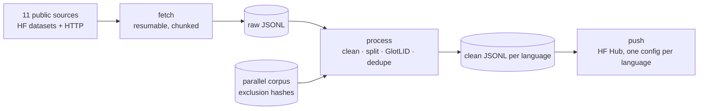

# sa-languages-corpus

[](https://huggingface.co/datasets/Mehgoss/sa-languages-corpus)

Monolingual text pipeline for 10 South African languages: Afrikaans, isiNdebele, Sepedi, siSwati,
Sesotho, Setswana, Xitsonga, Tshivenda, isiXhosa, isiZulu.

It pulls from every usable public source, cleans and sentence-splits, filters by GlotLID, dedupes
globally, **excludes anything already in `Mehgoss/sa-languages-translation`**, then pushes one config
per language to `Mehgoss/sa-languages-corpus`. Target: 1,000,000 unique sentences per language.

## Architecture



Runs two ways from the same code: locally / Colab via `run.py`, or on AWS (Step Functions →
container-image Lambdas → S3) deployed through GitHub Actions.

## Quick start

```bash
pip install -r requirements.txt
export HF_TOKEN=hf_xxx

python run.py fetch      # stream raw text    -> data/raw/{lang}/{source}.jsonl
python run.py process    # clean, langid, dedupe -> data/clean/{lang}.jsonl
python run.py report     # per-language counts vs the 1M target
python run.py push       # push configs to Mehgoss/sa-languages-corpus
```

Per language / per source:

```bash
python run.py fetch --langs zu xh --sources madlad400 hplt2
python run.py fetch --limit 200000        # cap raw docs per source (Colab / phone testing)
python run.py process --max 1000000       # stop at the target and move on
```

Fetch is resumable: completed `lang/source` pairs are marked in `data/state/` and skipped. A source
that 404s or has no config for a language is logged and skipped, not fatal.

```python
from datasets import load_dataset
zu = load_dataset("Mehgoss/sa-languages-corpus", "zu", split="train")
```

Schema: `text`, `lang`, `source`.

## Pipeline design

**Cleaning.** NFKC normalization, URL/email stripping, sentence splitting, then length, alphabetic
and digit-ratio filters, markup/junk detection and a lexical-diversity check.

**Language ID.** GlotLID (`cis-lmu/glotlid`), the only LID model that separates the Nguni languages
properly. Threshold 0.70 for nr/ss/zu/xh/st/nso/tn (crawl data constantly mislabels isiNdebele and
siSwati as isiZulu), 0.50 elsewhere. `--skip-langid` bypasses it for quick tests but pollutes the
low-resource configs.

**Dedup, two layers**, both on a normalized key (NFKC, lowercased, punctuation stripped, whitespace
collapsed) hashed to 64 bits:

1. Within-corpus, across all sources.
2. Against `Mehgoss/sa-languages-translation`. Target-side sentences of the parallel corpus are
   hashed into a sorted uint64 array cached at `data/state/exclude.{lang}.npy` and checked by binary
   search, so nothing already used in the first training run is repeated.

If the parallel repo's config names aren't `{lang}-en`, pass them to
`process.build_exclusion(lang, configs=[...])`.

## Sources

| Source | Type | Langs | Notes |
|---|---|---|---|
| MADLAD-400 (clean) | CC crawl | all 10 | Biggest single win. Document-level, audited, deduped. |
| HPLT v2 cleaned | CC + IA crawl | 8 (no nr, ve) | 193 languages, non-overlapping with OPUS. |
| GlotCC-V1 | CC crawl | all 10 | Built for long-tail langs; best nr/ss/ve recall. |
| mC4 | CC crawl | af xh zu st ts nso | Overlap with others handled by dedupe. |
| Glot500-c | mixed | all 10 | Aggregated + deduped, 511 languages. |
| Wikipedia | encyclopedic | 9 (no nr) | High quality, low volume. |
| Vuk'uzenzele | gov magazine | all 10 | DSFSI. Small, very clean, good register. |
| SA-Monolingual-Corpora | gov pubs | zu xh st nso | UCT thesis corpus. |
| PuoData | curated | tn | Best Setswana resource available. |
| Emotions corpora (michsethowusu) | curated | all 10 | Per-language HF repos. |
| Leipzig Corpora | web/news/wiki | all 10 | Pre-split sentences. Only public source with real nr coverage. |

Full list and per-language wiring live in `config.py`.

### Not wired up yet

- **NCHLT Text Corpora** (SADiLaR): all 11 languages, the cleanest SA text that exists.
- **Autshumato monolingual**: partly consumed by the parallel corpus; the exclusion step drops overlap.
- **Isolezwe** (isiZulu daily, via Newstools).
- **eBible / biblenlp-corpus**: ~31k verses per language, real volume for nr, ss, ve.
- **SABC / SAnews.gov.za / regional radio sites**: the only route to 1M for ve/ss/nr.

## Realistic yields

Expected unique sentences from public sources, estimated before a full run:

| Language | Code | Expected | 1M target |
|---|---|---|---|
| Afrikaans | af | 50M+ | easily |
| isiZulu | zu | 5–15M | yes |
| isiXhosa | xh | 3–8M | yes |
| Sesotho | st | 2–5M | yes |
| Setswana | tn | 1–3M | yes |
| Sepedi | nso | 0.8–2M | likely |
| Xitsonga | ts | 0.4–1.2M | borderline |
| Tshivenda | ve | 0.3–0.8M | needs scraping |
| siSwati | ss | 0.2–0.6M | needs scraping |
| isiNdebele | nr | 0.1–0.3M | needs scraping |

The bottom four are the whole problem: everything public is already crawled, so reaching 1M means
scraping SA broadcast/news sites directly or back-translating.

## AWS deployment

Fetch and process also run as container-image Lambdas orchestrated by Step Functions, so heavy
sources aren't tied to a Colab session. Setup and first deploy: **[aws/README-AWS.md](aws/README-AWS.md)**.
Least-privilege deploy permissions are in `deploy-policy.json`.

## CI/CD

- `ci.yml`: compile check, unit tests (`pytest`), and `sam validate --lint` on every push/PR. No AWS
  credentials needed.
- `deploy-aws.yml`: `sam build && sam deploy` on push to `main` (concurrency-guarded, auto-clears
  wedged CloudFormation stacks, prints the real failure reason on error). Needs `AWS_ACCESS_KEY_ID`,
  `AWS_SECRET_ACCESS_KEY` and `HF_TOKEN` as repo secrets.

## Tests

```bash
pip install pytest numpy
pytest -q
```

Covers normalization, dedup keys, sentence splitting, quality filters, exclusion lookup and the
Step Functions input builder.
